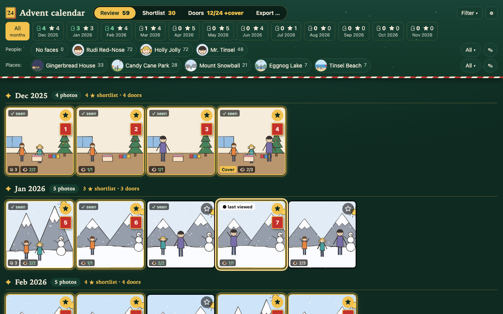

# Advent photo picker

A local tool that helps you pick 24 photos and a cover for a photo Advent calendar from a year of phone photos. It
sorts out blurry and dark photos, screenshots, duplicates and bursts, groups faces and places, and gives you one page
where every candidate sits next to the photos it sorted out. Every step runs on your computer. The scripts
download Python packages and three face models once. After that, your photos and the results stay on the machine. The
easiest way to get started is to let your AI agent set it up, see [below](#set-it-up-with-your-ai-agent). To look at
the page first, [try it with sketches](#try-it-without-your-photos).



I built it with Claude in one afternoon for my own calendar. The story is in the article
[24 photos for the grandparents, two days left](https://reinhardbuchinger.com/writing/advent-calendar-photo-picker/).

The interface is in English and German. It follows your browser's language, and the settings menu (⚙) switches it.
The door grid fits one calendar format (see Limits).

## Set it up with your AI agent

An AI coding agent such as Claude Code, Codex or Cursor can do the setup and run the scripts for you. Its
instructions are in [AGENTS.md](AGENTS.md). Start the agent in an empty folder and paste this:

```
Set up the Advent photo picker from https://github.com/grinser/advent-photo-picker on this
computer and follow its AGENTS.md. My photos are in [folder]. Use the photos from [date] on.
Don't upload my photos anywhere.
```

You still pick the photos yourself, in the page the agent opens for you. The rest of this README describes the same
steps for doing it by hand.

## Privacy

Everything runs on your computer, and these safeguards are built in:

- The scripts read your photo folder and never write to it. They refuse to run if the picker sits inside the photo
  folder.
- Only `download_models.py` goes online. The scripts that read your photos switch off network access for themselves,
  so a bug or a change cannot send anything.
- Place names come from an offline list inside the `reverse_geocoder` package, so GPS positions are not sent anywhere
  either.
- The page has a Content Security Policy that lets it load only files from this folder and blocks every connection to
  the internet. Your picks are saved in your browser's local storage.
- [AGENTS.md](AGENTS.md) tells AI agents never to look at your photos themselves, because whatever an agent looks at
  can go to its model provider. They work only from the scripts' output.

No safeguard is complete. If an agent sets the picker up for you, watch what it does. The code comes without
warranty, so use it at your own risk (see [LICENSE](LICENSE)).

Previews, face crops and results go into folders next to the scripts, which `.gitignore` keeps out of git. When you
are done, delete the folders `prev`, `thumbs`, `faces`, `work` and `calendar-photos` and the file `data.js`. Your
picks and the names you gave people stay in the browser until you clear the site data for the page, and a selection
file you saved stays where you saved it.

## What you need

- A Mac or a Windows PC. I have tested it with Python 3.14 on macOS and Python 3.12 on Windows 11. It should work on
  Linux too, but I have not tried.
- Python 3.10 or newer from [python.org](https://www.python.org/downloads/). On the Mac, use the installer from there,
  because the `python3` that comes with macOS first asks to install Apple's developer tools.
- About 1.5 GB of free disk space per 5,000 photos for previews.
- A current browser. I have used the page in Firefox and Safari, and the tests run in Chromium.
- An evening. Setup takes about 15 minutes, the first pass about half an hour per 6,000 photos, then you pick.

## Get your photos into a folder

The scripts read one folder, including its subfolders. HEIC and JPEG both work.

- **Mac, Photos app:** select the photos, then File › Export › Export Unmodified Originals. If your library is in
  iCloud, Photos downloads the originals first, which can take a while. The scripts skip the Photos library itself, so
  export first.
- **iPhone on Windows:** connect the phone, open it in File Explorer and copy the `DCIM` folder.
- **Anything else:** any folder of photo files works, for example a Google Takeout download.

## Setup

Download the code: take the ZIP of the newest [release](https://github.com/grinser/advent-photo-picker/releases)
(what changed is in [CHANGELOG.md](CHANGELOG.md)), or click Code › Download ZIP on this page for the newest state, and
unzip it. Then open a terminal in that folder.

- **Mac:** open Terminal, type `cd ` (with a space), drag the unzipped folder into the window and press Enter.
- **Windows:** open the unzipped folder in File Explorer, click into the address bar, type `cmd` and press Enter.
  This opens the Command Prompt. If the line in the window starts with `PS`, you are in PowerShell, where the commands
  below do not work. Type `cmd` and press Enter.

On the Mac:

```sh
python3 -m venv .venv
. .venv/bin/activate
pip install -r requirements.txt
python download_models.py
```

On Windows:

```bat
py -m venv .venv
.venv\Scripts\activate
pip install -r requirements.txt
python download_models.py
```

The last line downloads the three face models, about 330 MB.

## Run

```sh
python process.py
python arc.py
python build.py
```

`process.py` asks two things: the folder with your photos (drag it into the window and press Enter) and the first day
to include, for example `2025-12-01`. Press Enter at the second question to take the last 365 days. It remembers both
answers for later runs.

You can also set them up front, which skips the questions. On the Mac:

```sh
export PHOTOS="$HOME/Pictures/advent-export"
export START=2025-12-01
```

On Windows (no quotes, even if the path has spaces):

```bat
set PHOTOS=C:\Users\you\Pictures\advent-export
set START=2025-12-01
```

There is no end date. The scripts take every photo from `START` until today.

`process.py` reads every photo once and measures sharpness, brightness and faces. For my 6,041 image files it took
about half an hour, and it shows how much is left. `arc.py` computes better face features, so similar faces such as
siblings end up in separate groups. `build.py` finds bursts, duplicates, places and people and writes `data.js` for
the page. Each script says at the end what to run next. If you stop `process.py` or `arc.py`, start it again and it
continues where it stopped.

Then open `index.html` in your browser: `open index.html` on the Mac, `start index.html` on Windows, or double-click
the file.

If you come back later in a new window, go to the folder again and run the activate line from Setup. To switch to
another photo folder or another first day, delete the folders `work`, `prev` and `thumbs` and start again.

Optional: `look2.py` estimates whether eyes are open and looking at the camera. It needs `mediapipe==0.10.14`, which
has no packages for Python newer than 3.12, so it gets its own environment. Run it after `arc.py`. On the Mac:

```sh
python3.12 -m venv .venv-look
.venv-look/bin/pip install -r requirements-look.txt
.venv-look/bin/python look2.py
python build.py
```

On Windows, with Python 3.12 installed:

```bat
py -3.12 -m venv .venv-look
.venv-look\Scripts\pip install -r requirements-look.txt
.venv-look\Scripts\python look2.py
python build.py
```

Set `HOME_COUNTRY` (for example `AT`) before `build.py` to drop the country code from place names at home.

### Photos from a second person

Set `EXTRA` to add the photos of someone else, for example a partner, as a second source. Your `PHOTOS` stay as they
are, and so do your picks in the browser. Give the source a short name before the `=`; several sources are separated
by `;`.

```sh
export EXTRA="partner=$HOME/Pictures/partner-export"   # Windows: set EXTRA=partner=C:\Users\you\Pictures\partner
python process.py && python build.py
```

`process.py` reads only the new photos. `build.py` then marks WhatsApp images (no camera data, no date and a typical
WhatsApp size, or a name like `IMG-20250101-WA0001`) and compares every photo of the second source with yours
(perceptual hash with [ImageHash](https://github.com/JohannesBuchner/imagehash) and the same aspect ratio). A photo
that matches one of yours is one you sent, so it is sorted out as "sent by you" and takes the date of your original.
In the page, Filter › Source shows all photos, only yours, only the other person's, or the ones you sent. `WA_T`
(default 24 of 256 bits) sets how close a match has to be. Only your photos from `START` on are compared.

## Use the picker

The page reads from top to bottom like this:

- **Review, Shortlist, Doors:** Review shows every candidate, Shortlist the photos you starred, Doors the 24 doors and
  the cover.
- **Months:** each button shows the doors (door symbol) and the starred photos (★) for that month, so you see which
  months are still empty.
- **People and Places:** click a chip to see only those photos. "All ▾" at the end of a row opens a list with a search box, and
  ✎ next to it lets you rename entries and merge the ones that belong together.
- **Star:** click ☆ on a photo to put it on the shortlist. There is no limit.
- **Door:** a + then appears under the star. Click it to make the photo one of the 24 doors. You can pick more than 24
  while you decide; the counter then shows how many are too many, and the export waits until 24 are left. Doors are
  numbered by date. To change that, fix a number in the large view, or drag one door onto another in the Doors view
  to swap them.
- **Large view:** open a photo to compare it with the rest of its burst, moment, place or person, to make it the
  cover, or to reject it. For a door, a square shows roughly what the door will show. For the cover, dashed squares
  show where the doors sit. Drag the frame to move the crop, double-click it to centre it again. You set the
  final crop in your photo service's software.

The scripts sort out blurry and dark photos, duplicates and screenshots. The settings menu (⚙) shows them again. Your
choices are saved in the browser's local storage, and the URL keeps filters and scroll position. "Save selection as
file" in the export dialog writes a backup.

When you are done, Export … gives you a command for Terminal (Mac) or Command Prompt (Windows). It runs `export.py`,
which copies the 25 photos as JPEG into `calendar-photos/` next to the scripts and leaves the originals alone. The
files are named `00_cover_…` and `01_…` to `24_…`, so the number is the door. If you export again, the new photos
replace the old ones. `calendar-photos/crops.json` lists where each crop sits, for the [recipe](RECIPE.md) that fills
a project file. Then drag the photos into your photo service's software and check the crop of every door there.

To let an AI agent put them into the calendar project for you, see [RECIPE.md](RECIPE.md).

## Try it without your photos

```sh
python make_demo.py
```

Then open `demo/index.html` in your browser. It shows sketches instead of photos and keeps its picks apart from
yours. It needs Python with Pillow, so run it after Setup.

## Limits

- "Looking at the camera" is an estimate. I have not checked how often it is right, and faces under 80 pixels get no
  verdict.
- Children who look alike are hard for the face model. Expect to merge small groups by hand.
- The "No faces" filter hides every photo with a face hit, even an uncertain one. People seen from behind or far away
  have no face hit, so they can still show up there.
- The door grid matches one calendar format (BIPA/CEWE, landscape). Other formats need other numbers in `index.html`.

## Licenses

The code is under the MIT license, see [LICENSE](LICENSE). The models are not part of the repo and keep their own
licenses: YuNet (MIT) and SFace (Apache 2.0) from the [OpenCV Zoo](https://github.com/opencv/opencv_zoo), and the
ArcFace model from [InsightFace](https://github.com/deepinsight/insightface), whose pretrained models are for
non-commercial research only. I use it for a private calendar that nobody pays for, and I read the terms as allowing that.
If you want to be on the safe side or use the tool commercially, skip `arc.py`. `build.py` then groups faces with
SFace, which tells similar faces such as siblings apart less well.
